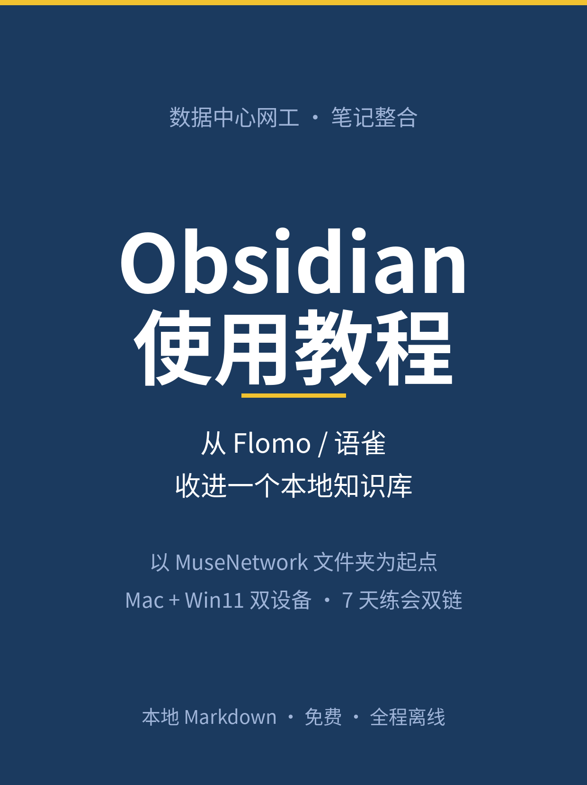
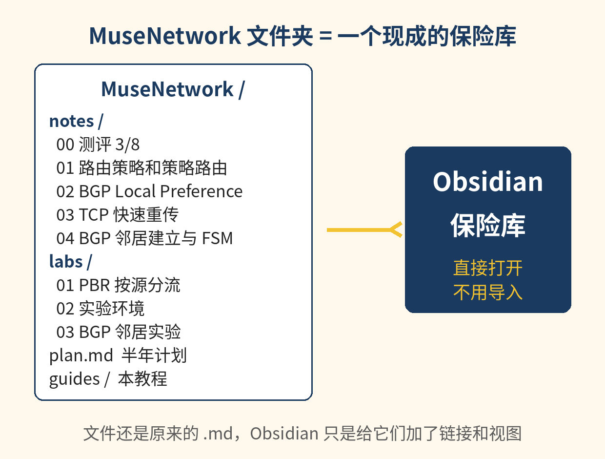
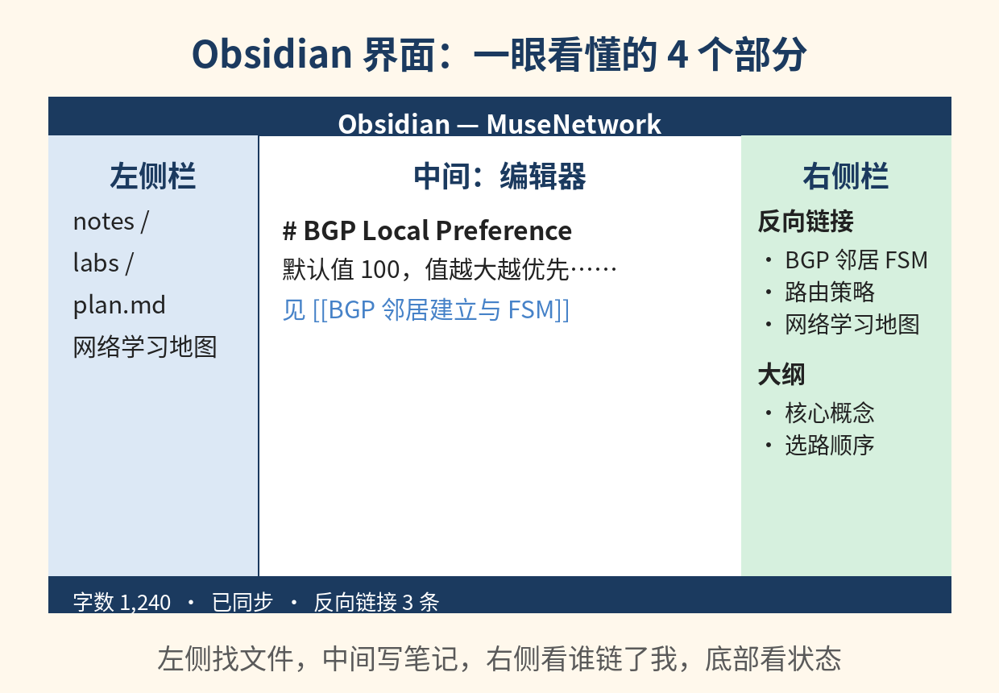
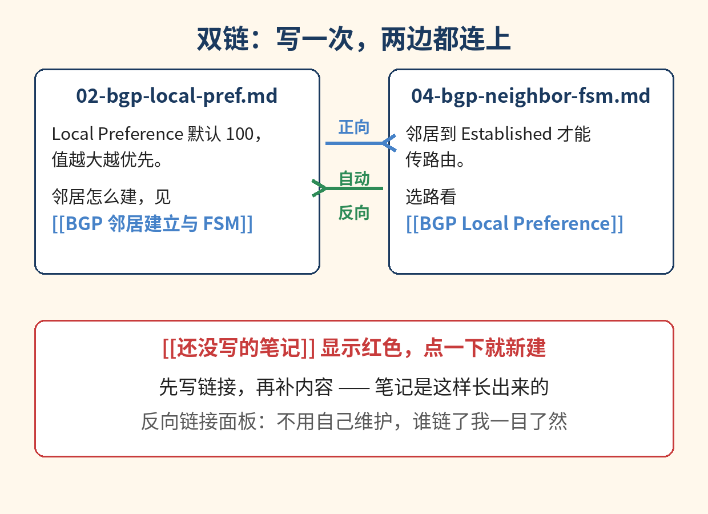
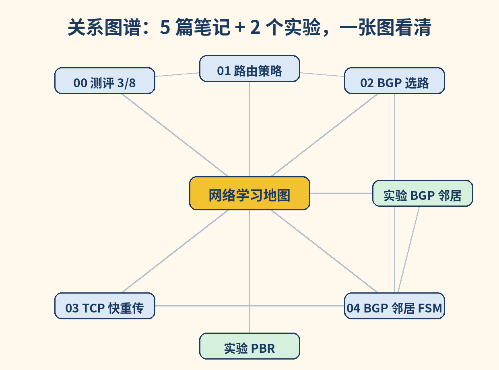
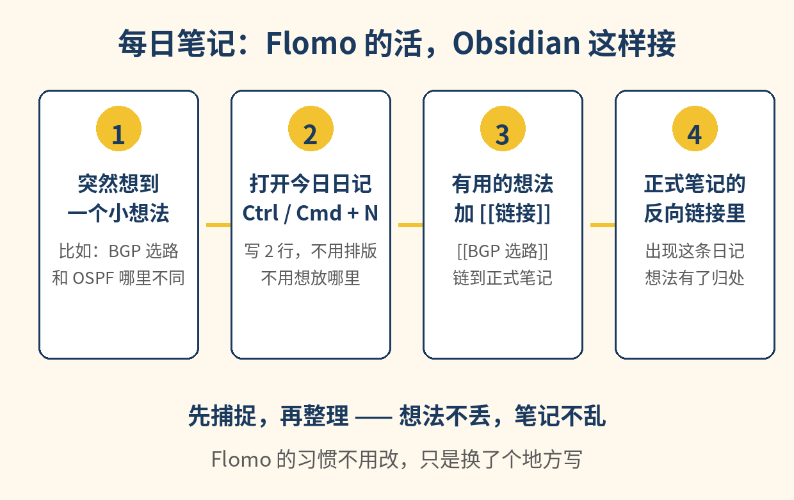
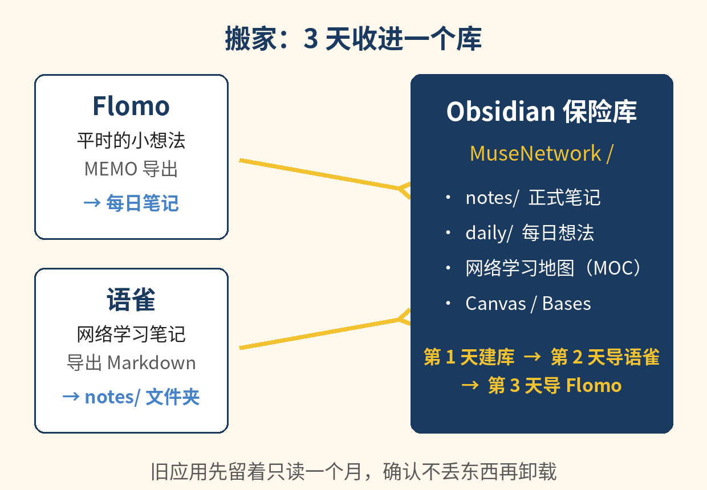

**写给谁：** 数据中心网工，正在半年冲高级，平时用 Flomo 记小想法、用语雀写网络学习笔记，最近开始学 Obsidian，但还不会关联笔记。

**这本教程的起点：** 你的 MuseNetwork 文件夹（notes/ 5 篇笔记、labs/ 3 个实验、plan.md）已经是现成的 Markdown 文件夹 —— 它就是一个等着被打开的 Obsidian 保险库，不用重写、不用导入。

---

## Part 0 结论先行：选 Obsidian

**一句话结论：把 Flomo 和语雀都收进 Obsidian，只留这一个。**

5 个理由，都和你的情况直接相关：

1. **你的笔记已经是 Markdown，Obsidian 不用搬家。** MuseNetwork 文件夹里的 .md 文件，Obsidian 打开就能用。选 Notion 意味着把所有笔记重新搬进一个专有格式，再想出来还得再导一次。
2. **你缺的正是 Obsidian 最强的那一项：关联笔记。** 双链 `[[ ]]`、反向链接、关系图谱是 Obsidian 的核心能力，不是插件。Notion 没有内置图谱，笔记之间只能靠数据库关联，越记越散。
3. **免费。** Obsidian 核心功能个人和商业使用都完全免费，不用注册、不用账号。Notion 免费版够用，但要好用的版本历史和上传额度就得付费（Plus 每月 10 美元，按年付）。
4. **全程离线。** Obsidian 默认就是本地软件，没网照常用。Notion 的离线模式 2025 年 8 月才有，而且要逐页标记“离线可用”，每个视图只下载约 50 行数据库内容，浏览器版完全没有离线。
5. **没有锁定。** 笔记就是你电脑上的普通文件，哪天不用 Obsidian 了，文件还在，随便换别的 Markdown 工具接着用。

**说实话，Notion 什么时候更好：** 需要多人实时协作、重度数据库和表单（比如团队项目管理、CRM），Notion 是更好的选择。但你的笔记是个人学习用的，不需要实时协作，数据库也用不上 —— 那些优势你用不着，代价（专有格式、在线依赖、没有图谱）却要全付。

---

## Part 1 对比表：Obsidian vs Notion

| 维度 | Obsidian | Notion |
| --- | --- | --- |
| 价格 | 核心功能完全免费，个人和商业都免费，不用注册 | 免费版个人无限页面/块，上传单文件 5 MB，页面历史 7 天；Plus 每月 10 美元（按年付），Business 每月 20 美元（按年付，含完整 Notion AI） |
| 笔记存在哪 | 你电脑上的普通 Markdown 文件，一个文件夹就是一个保险库 | 存在 Notion 的服务器上，本地只留缓存 |
| 离线 | 默认全程离线，没网照常用 | 2025 年 8 月才有离线模式，要逐页标记“离线可用”，每个数据库视图只下载约 50 行，浏览器版无离线，AI/自动化/嵌入要联网 |
| 链接 / 图谱 | `[[双链]]`、反向链接、全局和局部关系图谱，都是内置核心功能 | 页面可以互相链接，但没有内置图谱；关联主要靠数据库 |
| 数据库 | Bases（v1.9 起的核心插件）：表格/卡片/看板视图，数据还在 Markdown 里 | 数据库是 Notion 最强项，视图、筛选、公式都很成熟 |
| 导出 / 锁定 | 无锁定：文件本来就是你的，随时能走 | 能导出 Markdown/CSV/HTML，但数据库导出是 CSV，复杂排版、同步块、嵌入常常还原不完整 |
| 多设备同步 | 官方 Obsidian Sync 每月 4 美元（按年付），端到端加密；也可以用 iCloud 等第三方同步 | 账号登录即同步，免费版就有 |
| 协作 | 个人工具，不适合多人实时协作 | 多人实时协作、评论、权限管理都很成熟 |
| 学习曲线 | 第一周要学双链、属性、插件，之后越用越顺 | 上手快，界面直观，但数据库和公式学深了也不简单 |

---

## Part 2 从 0 开始：安装 + 打开你的保险库

### 第 1 步：安装（Mac，5 分钟）

1. 打开浏览器，去 obsidian.md 下载 Mac 版。
2. 打开下载的 .dmg，把 Obsidian 拖进“应用程序”。
3. 打开 Obsidian。第一次打开不用注册、不用登录 —— 没有账号这回事。

### 第 2 步：把 MuseNetwork 文件夹打开为保险库

1. Obsidian 左下角点“打开另一个保险库”（Open another vault）。
2. 选“打开文件夹作为保险库”（Open folder as vault）。
3. 找到你桌面上的 MuseNetwork 文件夹，点“打开”。
4. 弹出“是否信任这个保险库的作者”，点“信任作者并启用插件” —— 这是你自己的文件夹，放心点。



打开后左侧文件列表里就是你熟悉的东西：notes/ 5 篇笔记、labs/ 3 个实验、plan.md。文件还是原来的 .md，Obsidian 只是给它们加了一层链接和视图。

### 第 3 步：认识界面



- **左侧栏：** 文件列表，找笔记的地方。点一下文件名就在中间打开。
- **中间：编辑器。** 写笔记的地方。`Ctrl / Cmd + E` 在编辑和阅读模式之间切换。
- **右侧栏：** 反向链接和大纲。打开一篇笔记，右侧立刻告诉你“谁链了我”。
- **底部状态栏：** 字数、同步状态、反向链接数。

先不用记快捷键，记住这 4 个位置就够了。

---

## Part 3 关联笔记：这才是 Obsidian 的核心



### 3.1 双链怎么写

在笔记里输入 `[[`，Obsidian 会弹出你所有笔记的列表，上下键选一篇，回车 —— 链接就写好了。格式是这样的：

```
[[BGP 邻居建立与 FSM]]
```

显示出来就是一个可以点的链接。点一下跳过去，再点返回就回来。

**先做一个前提动作：把文件名改成能读的名字。** 链接认的是文件名，不是正文里的大标题。你现在的文件名是 `04-bgp-neighbor-fsm.md`，直接写 `[[BGP 邻居建立与 FSM]]` 是链不上的。改名很简单：在左侧文件列表里右键点文件名 → “重命名”，Obsidian 会自动更新所有引用它的链接，不用手动改。建议改成这样：

| 现在的文件名 | 改成 |
| --- | --- |
| notes/00-baseline-assessment.md | 起点测评 3/8 复盘.md |
| notes/01-routing-policy-and-pbr.md | 路由策略和策略路由.md |
| notes/02-bgp-local-pref.md | BGP Local Preference.md |
| notes/03-tcp-fast-retransmit.md | TCP 快速重传与拥塞控制.md |
| notes/04-bgp-neighbor-fsm.md | BGP 邻居建立与 FSM.md |
| labs/01-pbr-lab.md | PBR 按源分流实验.md |
| labs/03-bgp-neighbor-lab.md | BGP 邻居实验.md |
| plan.md | 半年学习计划.md |

改完之后，下面的例子就都能直接用了。编号不用担心丢：顺序由“网络学习地图”那篇笔记来管（见 3.9），不是由文件名管。

**红链是新建笔记最快的方法：** 输入一个还不存在的笔记名，比如 `[[OSPF 邻居建立]]`，它会显示成红色。点一下这个红色链接，Obsidian 马上新建这篇笔记 —— 先写链接，再补内容，笔记就是这样长出来的。

### 3.2 实战 1：在 02 里链到 04

打开 `notes/02-bgp-local-pref.md`，在“Local Preference”那节末尾加一行：

```
邻居怎么建立，见 [[BGP 邻居建立与 FSM]]
```

注意：链接用的是改名后的文件名，不是正文里的大标题。改名之后，`[[BGP 邻居建立与 FSM]]` 才能链上。

### 3.3 实战 2：在 04 里链回来

打开 `notes/04-bgp-neighbor-fsm.md`，在“选路”相关的位置加一行：

```
邻居建好之后怎么选路，看 [[BGP Local Preference]]
```

这样 02 和 04 就互相连上了。以后不管从哪一篇进去，都能顺着链接走到另一篇。

### 3.4 实战 3：在 01 里连起两条线

打开 `notes/01-routing-policy-and-pbr.md`，加两行：

```
路由策略改的是路由属性，细节见 [[BGP Local Preference]]
策略路由改的是转发行为，实验见 [[PBR 按源分流实验]]
```

一篇笔记里可以链很多篇，链多少都行。

### 3.5 链接的 4 个进阶写法

**别名：** 显示的文字和目标不一样，用 `|` 分开：

```
[[BGP 邻居建立与 FSM|邻居建立那篇]]
```

读起来是“邻居建立那篇”，点进去是 04。

**链到小节：** 用 `#` 指向笔记里的某个标题：

```
[[BGP 邻居建立与 FSM#5 种报文]]
```

点进去直接跳到“5 种报文”那节。

**嵌入整篇笔记：** 前面加一个 `!`，整篇笔记的内容会嵌进来显示：

```
![[BGP 邻居建立与 FSM]]
```

适合在“网络学习地图”里把几篇笔记的关键部分拼在一起看。

**链到还没写的笔记：** 直接写 `[[OSPF 基础与邻居]]`，红色链接先占位，等学到 OSPF 那天点一下就开写。

### 3.6 反向链接：不用自己维护的目录

打开 `notes/02-bgp-local-pref.md`，看右侧栏的“反向链接”（Backlinks）。你会看到 04 和 01 —— 因为它们都链了 02。反向链接分两栏：

- **已链接提及（Linked mentions）：** 写了 `[[...]]` 链过来的笔记。
- **未链接提及（Unlinked mentions）：** 正文里提到了这个词、但还没写成链接的笔记。点一下就能一键转成链接。

反向链接是自动的：你只管在正向写 `[[ ]]`，反向那边 Obsidian 帮你记。

### 3.7 图谱：全局和局部

按 `Ctrl / Cmd + G` 打开全局图谱。每个点是一篇笔记，每条线是一个链接。你的 5 篇笔记 + 2 个实验连起来，大概是这个样子：



- **全局图谱：** 整个库的连接情况。点越密，说明这篇笔记越“枢纽”。你的“网络学习地图”应该是最密的那个点。
- **局部图谱：** 在一篇笔记里点右上角“打开局部图谱”，只看这篇笔记的一圈邻居。复习 BGP 的时候，只看 BGP 那一圈，不被别的干扰。

图谱不是拿来看热闹的：复习前打开图谱，孤立的点（没有线连进来的笔记）就是还没被串起来的知识，补一条链接就串上了。

### 3.8 标签 vs 链接：什么时候用哪个

- **链接：** 用 `[[ ]]` 表示“这两篇笔记有关系”。BGP 选路和 BGP 邻居、PBR 实验和路由策略 —— 用链接。
- **标签：** 用 `#` 表示“这篇笔记属于哪一类”。比如 `#BGP`、`#实验`、`#待复习`、`#面试题`。标签是分类，链接是关系。

一个简单的规矩：关系用链接，分类用标签。不要用标签去代替链接，否则图谱永远连不起来。

### 3.9 地图笔记（MOC）：给你的库一张目录

新建一篇笔记，标题就叫“网络学习地图”，内容只写链接，不写正文：

```
# 网络学习地图

## 起点
- [[起点测评 3/8 复盘]]
- [[半年学习计划]]

## BGP（第 1 个月）
- [[BGP Local Preference]]
- [[BGP 邻居建立与 FSM]]
- [[BGP 邻居实验]]

## TCP
- [[TCP 快速重传与拥塞控制]]

## 路由策略
- [[路由策略和策略路由]]
- [[PBR 按源分流实验]]

## 待学（红链占位）
- [[OSPF 基础与邻居]]
- [[VLAN 与 Native VLAN]]
- [[STP 与 RSTP]]
```

这篇笔记就是你的学习地图：新学一讲，先在地图里加一行链接，再点进去写。半年后，地图就是你的知识目录。

---

## Part 4 整理：文件夹、属性、每日笔记、模板

### 4.1 文件夹结构

文件名改完之后，文件夹按用途分，不按时间分：

```
MuseNetwork/
├── notes/          正式笔记：一篇一个知识点
├── labs/           实验：设计、步骤、结果、复盘
├── daily/          每日笔记：每天一个文件，想法先落在这里
├── maps/           地图笔记：网络学习地图、各专题地图
├── templates/      模板：新建笔记时套用
├── plan.md         半年学习计划
└── guides/         本教程
```

规矩只有一条：**正式笔记只进 notes/ 和 labs/，不进 daily/**。daily/ 是草稿箱，想法在那里出生，成型了再链到正式笔记。

### 4.2 属性（Properties）：给每篇笔记贴 3 个标签

在笔记最顶上写一段 frontmatter（前后各三个短横线），Obsidian 会把它认成属性，可以在 Bases 里做表格：

```
---
status: 学习中
topic: BGP
date: 2026-11-08
---
```

- **status：** 未开始 / 学习中 / 已掌握 / 待复习。复习的时候按 status 筛，一眼看到哪些还没掌握。
- **topic：** BGP / TCP / OSPF / 交换 / 安全。按 topic 分组，就是你的专题地图。
- **date：** 这篇笔记写成的日期。Bases 按 date 排序，就是你的学习时间线。

写新笔记的时候先贴这 3 行，10 秒钟，之后检索全靠它们。

### 4.3 每日笔记：Flomo 的活，Obsidian 这样接



Flomo 的习惯不用改，只是换了个地方写：

1. **打开设置：** 左下角齿轮 → 核心插件 → 确认“每日笔记”已开启。
2. **设好位置：** 在每日笔记设置里，文件位置填 `daily/`，日期格式用 `YYYY-MM-DD`，模板后面再配（见 4.4）。
3. **记想法：** 按 `Ctrl / Cmd + N`，今天的日记就打开了。想到什么写 2 行，不用排版、不用想放哪里。
4. **转成正式笔记：** 晚上花 5 分钟翻一遍今天的日记，有用的想法加一个 `[[链接]]` 链到正式笔记，或者直接在日记里写一行 `[[新笔记名]]` 红链，明天点进去写。

先捕捉，再整理 —— 想法不丢，笔记不乱。Flomo 里的旧想法按 Part 7 导进来之后，新的小想法就都写每日笔记里。

### 4.4 模板：一篇新协议笔记的固定格式

在 templates/ 里新建一篇笔记，叫“协议笔记模板”，内容如下：

```
---
status: 学习中
topic:
date: {{date}}
---

# {{title}}

## 一句话
（这篇笔记解决什么问题，一句话写清）

## 核心概念
-

## 华为配置
# 在这里贴华为配置

## 排障案例
1.
2.
3.

## 自测
- [ ]
- [ ]

## 关联
- [[ ]]
```

新建笔记的时候用 `Ctrl / Cmd + P` 打开命令面板，输入“插入模板”，选这篇模板，格式就套好了。`{{date}}` 和 `{{title}}` 是模板变量，插入时 Obsidian 会自动填。模板的好处不是好看，是每篇笔记都有同样的骨架，复习的时候不用重新找结构。

---

## Part 5 检索与回顾：搜索、Canvas、Bases

### 5.1 搜索：4 个最常用的语法

按 `Ctrl / Cmd + Shift + F` 打开全局搜索：

| 语法 | 意思 | 例子 |
| --- | --- | --- |
| `tag:标签名` | 找出带这个标签的笔记 | `tag:待复习` |
| `path:文件夹` | 只在某个文件夹里搜 | `path:labs PBR` |
| `line:(A B)` | 同一行里同时出现两个词 | `line:(选路 出口)` |
| `file:文件名` | 按文件名搜 | `file:BGP` |

再加两个习惯：搜之前先想“我要找的是哪一类东西”—— 找复习材料用 `tag:待复习`，找实验用 `path:labs`，找一句话用 `line:(...)`。搜到的结果可以直接点进去，不用一个个文件夹翻。

### 5.2 Canvas：把 BGP 摆在一张白板上

Canvas 是 Obsidian 的无限白板（核心插件，左侧栏点 Canvas 图标新建）：

1. 新建一个 Canvas，叫“BGP 复习板”。
2. 从左侧文件列表把这 4 篇笔记拖进来：`BGP Local Preference`、`BGP 邻居建立与 FSM`、`BGP 邻居实验`、`路由策略和策略路由`。
3. 按学习顺序从左到右排：邻居建立 → 选路 → 策略 → 实验。
4. 用箭头把它们连起来，在连线旁边写一句话：“邻居到 Established 才能传路由”“Local Preference 决定出站出口”。
5. 空白处加一张卡片，写 3 道你最容易错的自测题。

Canvas 的好处是“空间记忆”：下次复习 BGP，先看这张板，4 篇笔记的位置关系就是知识结构。考前 10 分钟看板，比翻 4 篇笔记快。

### 5.3 Bases：你的学习进度表（不用写代码）

Bases 是 Obsidian v1.9 起的核心插件，数据库式的表格/卡片/看板视图，数据还存在 Markdown 的属性里，不用学 Dataview 代码：

1. 在 maps/ 里新建一个 Bases，叫“学习进度”。
2. 数据源选整个保险库，视图选“表格”。
3. 显示的列选：文件名、status、topic、date。
4. 按 date 排序，再按 status 分组。

你会得到一张表：每一行是一篇笔记，状态一目了然 —— 哪些是“学习中”，哪些是“待复习”。每周日晚上打开这张表，挑 2 篇“待复习”的过一遍，复习就有了固定入口。

---

## Part 6 多设备同步：Mac + Win11 笔记本

你在 Mac 上记笔记，在 Win11 笔记本上做实验（eNSP/HCL），两边都要能看到同一个库。两条路线：

### 路线 A：Obsidian Sync（最省心，每月 4 美元）

1. Mac 上：设置 → 同步 → 登录 Obsidian 账号（同步用的账号，免费注册）→ 选“创建新同步保险库”。
2. 选好要同步的内容（笔记、图片、插件设置都可以勾上），等第一次同步完成。
3. Win11 笔记本上：装好 Obsidian → 设置 → 同步 → 登录同一个账号 → 选“连接已有的远程保险库”，选你的 MuseNetwork。
4. 之后两边改了都会自动同步。

Sync 是端到端加密的，Obsidian 官方也看不到你的笔记内容。每月 4 美元（按年付），1 个同步保险库，1 GB 空间 —— 你的 Markdown 笔记加起来不到几 MB，完全够用。

### 路线 B：iCloud（免费，但要小心）

1. Mac 上把 MuseNetwork 文件夹放进 iCloud 云盘（~/Library/Mobile Documents/com~apple~CloudDocs/ 下面）。
2. Win11 上装 iCloud for Windows，登录同一个 Apple ID，等文件夹同步下来。
3. 两边都用 Obsidian 打开那个文件夹。

免费是免费，但 iCloud 同步 Obsidian 有个已知风险：两边同时改同一篇笔记容易出同步冲突，Obsidian 会生成带“冲突”字样的副本文件，要手动合并。能接受偶尔手动处理，就用 iCloud；想要零摩擦，就用 Sync。

### 红线：不要同时用两种同步工具同步同一个库

只选一条路线。iCloud + Sync、iCloud + OneDrive、Dropbox + Sync —— 两种工具同时盯着同一个文件夹，冲突和丢数据的概率会大很多。选定一个，就把另一个彻底关掉。

---

## Part 7 搬家：3 天把 Flomo 和语雀收进来



### 第 1 天：建库 + 第一批链接（今天就能做）

1. 按 Part 2 把 MuseNetwork 文件夹打开为保险库。
2. 按 Part 3 的表把 8 个文件名改掉。
3. 在 02、04、01 三篇笔记里各加 1 条 `[[链接]]`。
4. 新建“网络学习地图”，把 5 篇笔记 + 2 个实验链进去。

做完这 4 步，库就算立起来了，后面都是往里面填东西。

### 第 2 天：语雀 → Obsidian

1. 语雀里打开一篇网络学习笔记，点导出 → 选 Markdown 格式，下载到电脑。
2. 把导出的 .md 文件移进保险库的 notes/ 文件夹。
3. **修图片路径：** 语雀导出的 Markdown 里图片常常是网络链接或 `images/` 相对路径。把图片文件一起拷进保险库的 `assets/` 文件夹，再把正文里的图片路径改成 `![[图片名.png]]` 的形式，Obsidian 就能显示了。
4. **补链接：** 读一遍刚导进来的笔记，提到 BGP、TCP 这些已有笔记的地方，顺手写成 `[[链接]]`。一篇笔记补 2–3 条就够了，不用一次补完。
5. 语雀里的原笔记先不动，留着对照一个月。

注意：语雀导出的是你自己的笔记，导出多少篇就导多少篇，不用一次全导完。先导最近在学的 3–5 篇，够用了再导下一批。

### 第 3 天：Flomo → Obsidian

1. Flomo 里导出 MEMO（Flomo 支持导出笔记）。
2. 有两种放法，选一种：
   - **按日期进每日笔记：** 把每条 MEMO 放进对应日期的 daily/ 文件里，前面加一行日期。适合想按时间回看的想法。
   - **合成一篇“灵感收集”：** 新建一篇笔记叫“灵感收集”，把所有 MEMO 按日期顺序贴进去，每条前面加日期。适合想法不多、想一眼看完的情况。
3. 读一遍导进来的想法，有用的加 `[[链接]]` 链到正式笔记；没用的留着，不用删。
4. 从今天起，新的小想法写 Obsidian 的每日笔记（Part 4.3），不再往 Flomo 里写。

### 搬家之后

| 做法 | 说明 |
| --- | --- |
| 旧应用先留着只读 | Flomo 和语雀先别卸载，确认东西都在 Obsidian 里、图片都能显示，再卸载 |
| 每天只导一批 | 一天导 3–5 篇语雀笔记，导完补链接，不要攒到周末一次导 30 篇 |
| 链接是最后一环 | 文件导进来只是“搬进来了”，补上 `[[链接]]` 才算“安顿好了” |

---

## Part 8 7 天练习计划

每天 15–20 分钟，用的都是你自己的 BGP/TCP 笔记：

| 天 | 任务 |
| --- | --- |
| 第 1 天 | 打开保险库，按 Part 3 的表改 8 个文件名，在 02（BGP LocalPref）里写第一条 `[[链接]]` |
| 第 2 天 | 打开 02 的右侧反向链接面板，看谁链了它；再找一条“未链接提及”转成链接（02、04） |
| 第 3 天 | 新建“网络学习地图”，把 5 篇笔记 + 2 个实验都链进去 |
| 第 4 天 | 按 `Ctrl / Cmd + N` 写今天的日记，把一个小想法用 `[[链接]]` 链到正式笔记（每日笔记 + 02） |
| 第 5 天 | 给 02、03、04 贴上 `#BGP`、`#待复习` 标签，再在顶上写好 status / topic / date 三行属性 |
| 第 6 天 | 按 `Ctrl / Cmd + G` 打开全局图谱，找一找有没有孤立的点（没线连进来的笔记），给它补一条链接 |
| 第 7 天 | 新建一个 Canvas 叫“BGP 复习板”，把 4 篇 BGP 笔记拖进去排好；或者新建一个 Bases 看学习进度表（04、02、01、实验） |

7 天做完，你就不是“会用 Obsidian”，而是“已经用 Obsidian 在学了”。

---

## Part 9 只装 3 个插件

Obsidian 有 7,500 多个社区插件，但第一周只装这 3 个，剩下的以后再说：

- **Dataview：** 用简单的查询语句生成表格，比如“列出所有 status 是待复习的笔记”。Bases 能做的事它都能做得更灵活，等 Bases 不够用了再装。
- **Templater：** 模板插件。Part 4.4 的“协议笔记模板”靠它实现自动填日期、自动填标题，比 Obsidian 自带的模板更顺手。
- **Excalidraw：** 手绘风白板插件。画网络拓扑草图、FSM 状态机、选路流程图，比截图和文字描述直观得多。

**警告：不要第一天就装 20 个插件。** 每个插件都是一份学习成本和一份出问题的可能。先把双链、每日笔记、地图笔记这 3 件事练熟，遇到具体卡点再装对应的插件 —— 装插件是为了解决问题，不是为了装插件。

---

## 完成清单：做到这样，就算成了

| 检查项 | 做到什么样 |
| --- | --- |
| 保险库能打开 | Obsidian 左侧能看到 MuseNetwork 的 notes/、labs/、plan.md |
| 8 个文件名改掉了 | 文件名是能读的中文标题，不再是 00-、01- 开头 |
| 5 篇笔记互相链上了 | 02 和 04 互相链，01 链了 02，打开任意一篇，右侧反向链接不是空的 |
| 地图笔记存在 | “网络学习地图”里有 5 篇笔记 + 2 个实验的链接 |
| 每日笔记写了一篇 | daily/ 里有今天的文件，里面至少有一个 `[[链接]]` |
| 标签和属性贴上了 | 至少 3 篇笔记有 `#标签`，顶上有 status / topic / date |
| 语雀导进来了 | 至少 3 篇语雀笔记在 notes/ 里，图片能显示 |
| Flomo 导进来了 | 旧想法在 daily/ 或“灵感收集”里，新的小想法开始写每日笔记 |
| 同步选好了 | Sync 或 iCloud 只开了一个，Win11 笔记本上能打开同一个库 |
| 图谱没有孤立点 | 按 `Ctrl / Cmd + G`，每篇笔记至少有一条线连着 |

打勾之后，Flomo 和语雀只读一个月，然后卸载。笔记从此只有一个家：MuseNetwork。
